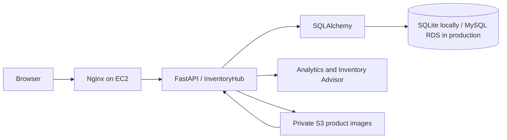

# InventoryHub

InventoryHub is a portfolio inventory and order-management application for small operations that need one place to manage catalogue items, stock movements, sales orders, suppliers, and practical stock-risk signals.

It is a complete local FastAPI application. AWS deployment artifacts are prepared for review, but no AWS infrastructure is deployed by this repository.

## Features

- Product catalogue: categories, search, filtering, create/edit, archive/restore APIs, stock levels, and low-stock flags.
- Inventory: stock-in, stock-out, adjustment, immutable movement history, and negative-stock protection.
- Orders and suppliers: item price snapshots, status transitions, stock deduction at processing, cancellation restoration, supplier-product links, and validation.
- Dashboard and Analytics: database-derived KPIs, order status counts, recent orders, six-month monthly revenue/order trends, sales by category, best sellers, and stock distribution.
- Inventory Advisor: read-only, rule-based reorder and stock-risk explanations derived from saved sales and movement history.
- Images: private S3 upload/replace/remove when configured, then verified local SKU image, then local fallback image.
- Security: bcrypt passwords, signed HttpOnly sessions backed by server-side tokens, CSRF checks, and authenticated business APIs.
- Demo data: a repeatable local-only seed with 50 products, 40 historical fictional orders, 10 fictional suppliers, and auditable stock history.

## Technology stack

Python, FastAPI, SQLAlchemy 2, SQLite for development, MySQL/RDS-compatible configuration, Jinja2, HTML/CSS/JavaScript, Chart.js, boto3, Pillow, pytest, Nginx, systemd, AWS S3, and CloudFormation deployment templates.

## Architecture



The app serves local static assets directly. Image resolution is: private S3 presigned URL, valid manifest-listed local SKU image, then `fallback.svg`.

## Project structure

```text
app/                    FastAPI routes, models, schemas, services, templates, static assets
scripts/                Admin bootstrap, catalogue/demo seeding, and validation utilities
tests/                  Socket-free functional tests
docs/                   Catalogue, S3, and AWS planning documentation
infrastructure/         CloudFormation, EC2 bootstrap, Nginx, systemd, and review scripts
SOURCES.md              Attribution for verified local catalogue images
```

## Local setup (PowerShell)

```powershell
git clone <your-repository-url>
cd "AWS Project - Inventory Order Management"
python -m venv .venv
.\.venv\Scripts\Activate.ps1
pip install -r requirements.txt
Copy-Item .env.example .env
```

Update `.env` with a unique `SESSION_SECRET`, then create the initial administrator account:

```powershell
python -m scripts.bootstrap_admin
python -m scripts.seed_demo_data
uvicorn app.main:app --reload
```

Open [http://127.0.0.1:8000](http://127.0.0.1:8000). API documentation is available at [http://127.0.0.1:8000/docs](http://127.0.0.1:8000/docs) in development only.

The application creates the SQLite schema at development startup. The SQLite compatibility routine is additive; production does not auto-migrate schemas.

## Demo data

`python -m scripts.seed_demo_data` is deliberately restricted to a development SQLite database. It is idempotent and creates only missing `DEMO-2026-` orders and labelled demo movements; it never deletes records. Run it on a clean local development database because it adds portfolio demonstration stock history.

Check the resulting data without modifying it:

```powershell
python -m scripts.verify_demo_data
python scripts/verify_catalogue_images.py
```

## Configuration

Use [.env.example](.env.example) as the authoritative variable list. The important values are:

| Variable | Purpose |
| --- | --- |
| `DATABASE_URL` | SQLite development URL or a MySQL SQLAlchemy URL. |
| `ENVIRONMENT` | `development` locally; production enables stricter checks. |
| `SESSION_SECRET` | Unique, long signing secret; required in production. |
| `SESSION_COOKIE_SECURE` | Must be `true` for HTTPS production. |
| `ADMIN_USERNAME`, `ADMIN_PASSWORD` | One-time local administrator bootstrap only. |
| `AWS_REGION`, `S3_BUCKET_NAME` | Optional private S3 image storage. |

Never commit `.env`, database files, credentials, session secrets, or AWS access keys.

## API overview

All business endpoints require an authenticated administrator session. Unsafe requests also require the session-bound `X-CSRF-Token` header.

- `/api/products`, `/api/categories`, `/api/products/{id}/inventory/*`
- `/api/orders`, `/api/suppliers`
- `/api/analytics/dashboard`, `/api/advisor`

Swagger/OpenAPI is enabled at `/docs` only outside production.

## Images and private S3

Product uploads accept JPEG, PNG, and WebP after extension, media-type, signature, and size validation. The bucket remains private; the application stores object metadata and generates short-lived presigned read URLs. If S3 is unavailable, normal product operations continue and local verified SKU images/fallbacks remain available.

Six catalogue images are currently verified and attribution-backed in `manifest.json` and [SOURCES.md](SOURCES.md). The remaining catalogue products intentionally use `fallback.svg`. Catalogue images are never uploaded to S3 automatically. See [docs/s3-product-images.md](docs/s3-product-images.md).

## Testing and quality checks

```powershell
python -m pytest -q -p no:cacheprovider
python -m compileall -q app scripts
node --check app/static/js/dashboard.js
node --check app/static/js/operations.js
node --check app/static/js/products.js
python scripts/verify_catalogue_images.py
python -m scripts.verify_demo_data
git diff --check
```

Latest verified result: **31 passing pytest tests**, valid manifest-backed local images, zero demo stock-reconciliation mismatches, and JavaScript/Python/whitespace checks passing.

## AWS deployment preparation

The repository contains a low-cost Mumbai (`ap-south-1`) Stage A plan: one public-subnet EC2 instance behind Nginx with SSM access. It intentionally does not create RDS, an ALB, NAT Gateway, DNS, TLS certificate, or S3 bucket.

Before any separately approved deployment, manually review:

1. CloudFormation parameters, subnet/security-group references, and the EC2 instance profile.
2. The private environment file at `/etc/inventoryhub/inventoryhub.env` with a unique secret and no access keys.
3. HTTPS, domain/certificate, and production MySQL/RDS plus a reviewed migration plan for a public production service.
4. Current Mumbai pricing, billing alerts, backup/restore process, and the least-privilege S3 policy if S3 is enabled.

Review only—do not execute—deployment preparation:

```powershell
.\infrastructure\scripts\verify-aws-prerequisites.ps1
.\infrastructure\scripts\deploy-ec2.ps1
```

The second command prints proposed AWS CLI arguments unless explicitly passed `-Execute`; do not use that switch without approval. See [infrastructure/ec2/deployment-notes.md](infrastructure/ec2/deployment-notes.md).

## Security notes

- Password hashes use bcrypt; plaintext passwords are not stored.
- Cookies are signed, HttpOnly, SameSite=Lax, and resolve to hashed, expiring server-side sessions.
- Production configuration rejects SQLite, placeholder/short session secrets, and insecure cookies.
- All state-changing APIs use CSRF validation.
- S3 image keys are generated server-side; bucket/object public access is not required.

## Screenshots

Add verified Dashboard, Products, Inventory, Orders, Analytics, and Advisor screenshots here before publishing the portfolio repository.

## Limitations and roadmap

- AWS resources and production MySQL migrations are not deployed or automated.
- HTTPS/domain/certificate and production backup/restore runbooks remain required before public deployment.
- Only six catalogue images have verified attribution; other products use the local fallback.
- Supplier-specific purchase trends require a future receipt/purchase-order model with a supplier foreign key.

## Author

Aditya Pujari
